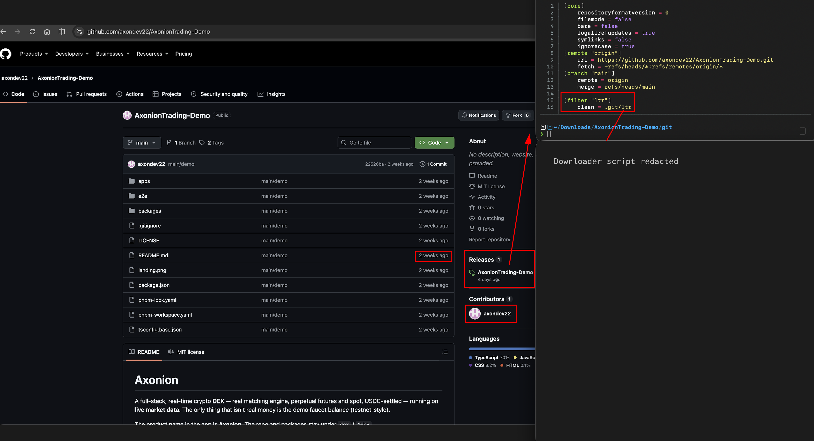
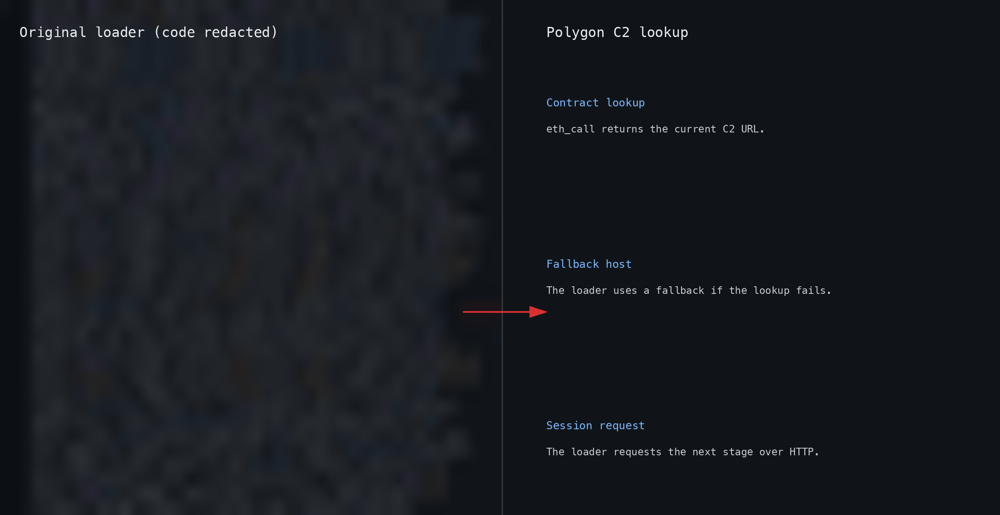

Contagious Interview is a malware campaign that targets software developers through fake job interviews. A recruiter gets a candidate on a call and gives them a project to review or run before the next round. The take-home assignment gives the recruiter a reason to send code and the candidate a reason to open it.

While researching Contagious Interview, I came across Axonion Trading Demo. It was presented as a take-home assignment after a LinkedIn conversation and a Google Meet call. The project looked like a plausible decentralized exchange demo, with a TypeScript matching engine and Playwright tests. In the ZIP attached to the GitHub release, I found a Git configuration that could start a downloader during a routine status check.

## What was in the release ZIP

Inside the release ZIP, the bundled `.git` directory contained a clean filter named `ltr`. Git can invoke a clean filter while checking the working tree, so a routine `git status` can be enough to launch it. An IDE that checks Git status can hit the same path before anyone installs a dependency.

_The Axonion release listing and the clean filter in the archive's Git configuration._

The filter script fetched a downloader hosted on Vercel. The samples I reviewed included a bundled Node.js runtime under `~/.cache/rt/` and loaders at `~/.vs_cache/main.js` and `~/.cache/rt/d.js`.

## Where the loader got its C2

The command-and-control (C2) URL in `d.js` came from Polygon. The loader queried a smart contract using `eth_call` to get the current address. The loader then requested a session over HTTP and ran the JavaScript it received. It also had a fallback host, `kkhf7a[.]s[.]gy`, for when the on-chain lookup failed.

_The loader is redacted on the left. The right panel summarizes the C2 lookup._

The samples I reviewed also included files labeled Ottercookie, NetSupport RAT, and a keylogger. I recognized the Polygon lookup from RST Cloud's report on HardHatRAT and Ottercookie. [RST Cloud's Ottercookie analysis](https://rstcloud.com/an-undocumented-ottercookie-lineage-build-and-its-invisible-c2-fleet/)

## Indicators of compromise

### GitHub accounts and downloads

I found `AxonionTrading-Demo.zip` attached to GitHub releases under `GLXY-a0x` and `axondev22`. I also came across `GLXY-RAS` while tracing the campaign on GitHub.

| Artifact | Indicator |
| --- | --- |
| Release ZIP (GLXY-a0x) | `hxxps://github[.]com/GLXY-a0x/axonion-trading-demo/releases/download/v1.0.1-alpha/AxonionTrading-Demo.zip` |
| Release ZIP (axondev22) | `hxxps://github[.]com/axondev22/AxonionTrading-Demo/releases/download/v1.0.1-alpha/AxonionTrading-Demo.zip` |
| macOS and Linux downloader | `hxxps://vercelscript[.]vercel[.]app/u/2fb2db57` |
| Windows downloader | `hxxps://vercelscript[.]vercel[.]app/w/2fb2db57` |

### Network

| Type | Indicator | Note |
|------|-----------|------|
| IP | `13[.]140[.]43[.]237` | C2 |
| IP | `13[.]140[.]228[.]125` | C2 |
| IP | `13[.]140[.]43[.]228` | C2 |
| IP | `38[.]92[.]47[.]167` | C2 |
| IP | `66[.]235[.]168[.]14` | C2 |
| IP | `150[.]241[.]203[.]68` | C2 |
| IP | `80[.]190[.]73[.]17` | C2 |
| IP | `80[.]190[.]79[.]39` | NetSupport RAT C2 |
| IP | `13[.]140[.]233[.]50` | NetSupport RAT C2 |
| Domain | `updpkg[.]net` | Reported first-stage download host |
| Domain | `kkhf7a[.]s[.]gy` | Fallback C2 in the loader |
| Domain | `dexcore-design[.]vercel[.]app` | Hosted the downloader scripts |
| Domain | `vercelscript[.]vercel[.]app` | Hosted the downloader scripts |
| Domain | `summer-bitter-slug[.]matic[.]quiknode[.]pro` | Polygon RPC endpoint seen in the loader. The URL path contained an access token. |
| Contract | `0x1a9700E5D74f64429594dF53EFCb6bc8c3936CB5` | Polygon smart contract used to resolve C2 address |
| HTTP path | `/session/b5b0cb4cae71351b` | Request path for the next stage |

### File hashes (SHA-256)

| Hash | Label |
|------|--------|
| `20eec270ef2943875af0f71795d07a7f8c8172d08fced86740ed88535407c3b7` | macOS and Linux downloader script |
| `e13ae6836d7b5dbc378b0c7b327c5b7c91b99bfce80c3af633f02fe6ea861494` | `w.sh` |
| `d3a1c3701616166cf72e6e7293c8fb1da0119593d19ee35f873048ca5891d9db` | `d.js` |
| `dccddc64d50e2594bed7f89f31114beee599e816570f3bfc9e96abf06b38fa3e` | `d.js` |
| `ada39027d2db8512d4ff2624e827b1ab6ffe3e7e281b1c1325aed85a89364e1f` | `main.js` |
| `cc6c4a9e261ed854d7aec9e9f618b5dcc46a1ad6ee200e3ef08cfe97da32cb7e` | Stealer binary (Ottercookie) |
| `b425a48b1adf6dc764e3196762f65c6b810049897d047cec6e75986b8d019d75` | Stealer binary (Ottercookie) |
| `1c5b565e482ca8a647bf587cd94849a45261887fe96ac6f37b3f4a9ea8625068` | Stealer DLL (Ottercookie) |
| `0757fd49eaa09dffcc2ab8fe482414ef2ec5f8fa2e77940a13cfd774532ddce4` | Stealer DLL (Ottercookie) |
| `5f409b2c01e8d3aabcf785b4f79f1f5b307272a080e60861433263e01edaef03` | NetSupport RAT |
| `b11380f81b0a704e8c7e84e8a37885f5879d12fbece311813a41992b3e9787f2` | NetSupport RAT |
| `c230870ce0e1f6d278e0e86d93e9da0a0e460e651f03da39bbabea8885781d90` | Keylogger downloader (JS) |
| `1e0cfdb71df64e16052af7159f996d794736540c2ba3e9864777bbbd16879b18` | Keylogger |

### Host artifacts

| Type | Indicator | Note |
|------|-----------|------|
| File path | `~/.vs_cache/main.js` | Primary loader |
| File path | `~/.cache/rt/w.sh` | Stage-1 script |
| File path | `/Users/*/.cache/rt/d.js` | Stage-2 Node loader |
| File path | `~/.cache/rt/n/bin/node` | Bundled Node runtime |
| File path | `/Users/*/.cache/rt/n.tgz` | Bundled Node archive |

## What I'd look for

I'd start with downloaded archives containing `.git/info/attributes` and a custom clean filter in `.git/config`. Inspect those as files. On endpoints, look for Git or an IDE spawning a shell, then check for Node.js running from `~/.cache/rt/` and file activity under both `~/.cache/rt/` and `~/.vs_cache/`. The two loader paths I'd search for are `~/.vs_cache/main.js` and `~/.cache/rt/d.js`. A match on a shared Polygon RPC hostname is more useful when it lines up with those host artifacts.

*The opinions expressed here are my own and not those of my employer.*
